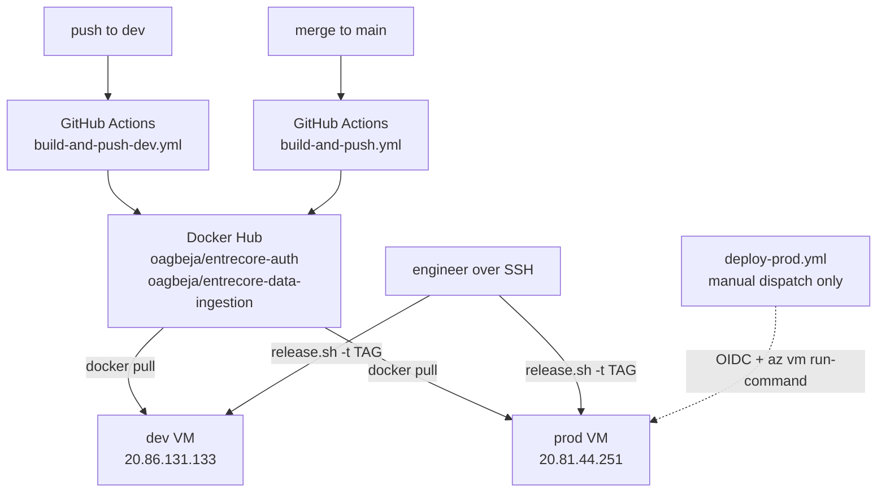
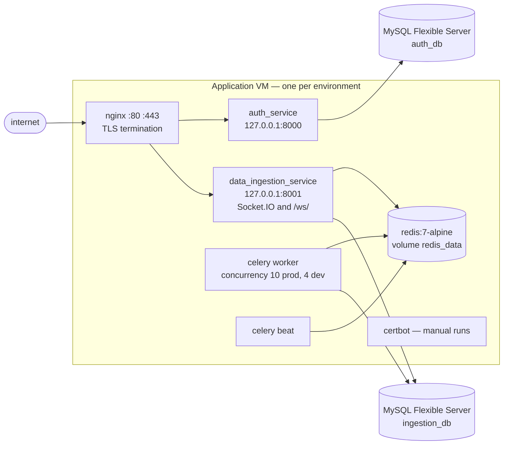
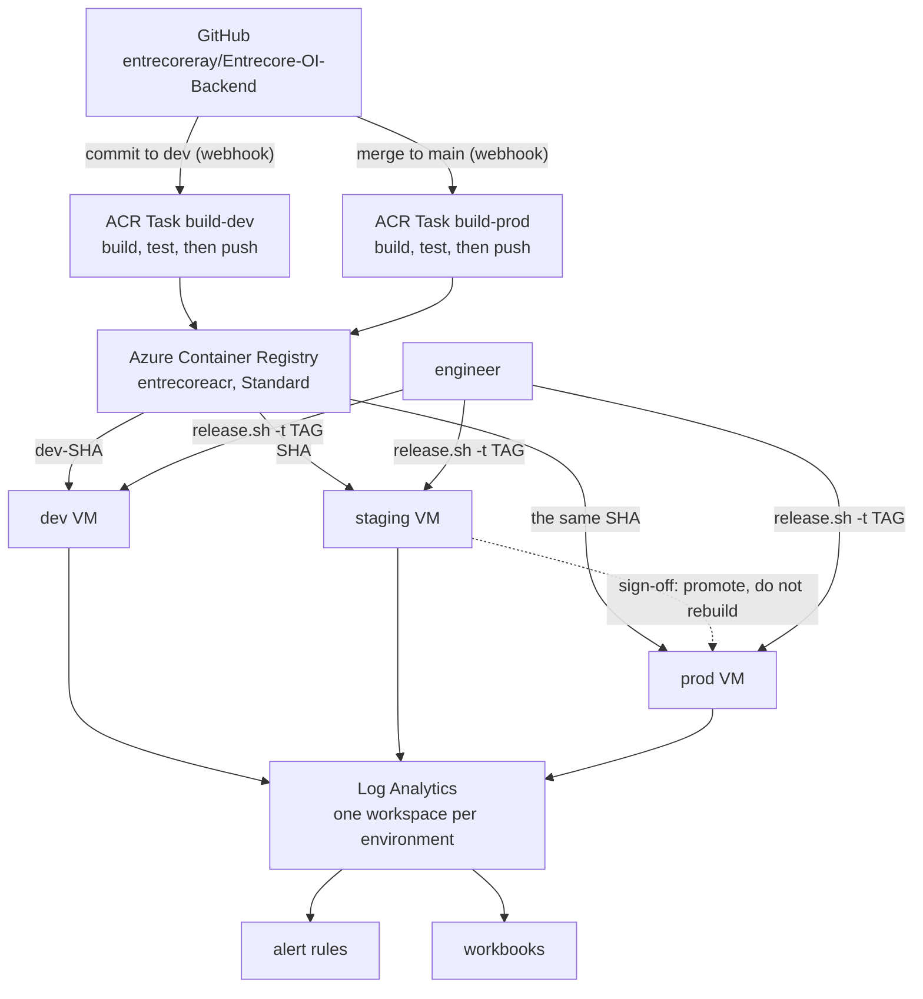
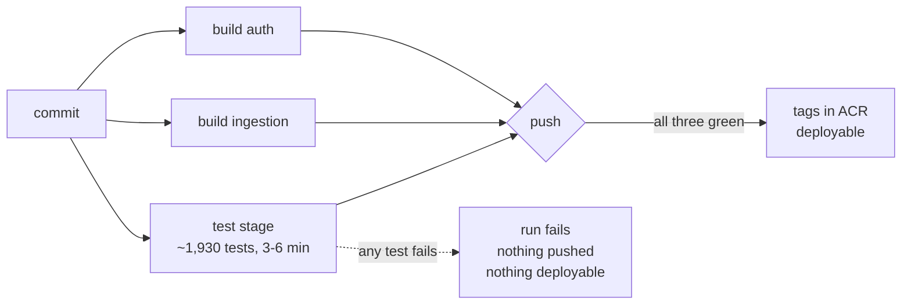
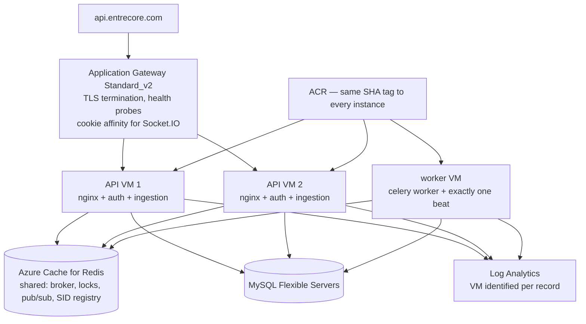

# Entrecore deployment architecture — current state and proposed direction

**Status:** assessment and proposal. Nothing in here has been deployed.
**Written:** 2026-10-13. **Audience:** Entrecore engineers.

This document answers two questions: what our build and deployment setup
actually is today, and where we are taking it. It is deliberately written
against the repository rather than against the older architecture docs —
`CODEBASE_DOCUMENTATION.md` (generated 2026-03-23) and `ARCHITECTURE_AUDIT.md`
(2026-05-12) both predate this work and are wrong in places that matter here.

The driving constraint: **GitHub Actions must not build our Docker images.**
Repository size, team size and runner cost rule it out. Builds move to Azure
Container Registry (ACR) Tasks. We are **not** moving the application to Azure
Container Apps — the VMs and Docker Compose stay.

The policy we are designing for is: **build automatically, deploy deliberately.**
A push to `main` may produce a production image. It must never replace the live
production containers on its own.

---

## 1. Where we are today

### 1.1 The pipeline that is actually running



Two GitHub Actions workflows build both images on every push and push them to a
**personal Docker Hub namespace** (`oagbeja`), authenticated with a personal
access token held as a repository secret:

| Workflow | Trigger | Tags published |
|---|---|---|
| `.github/workflows/build-and-push.yml` | push to `main` / `master` | `latest`, `<sha>` |
| `.github/workflows/build-and-push-dev.yml` | push to `develop` / `dev` | `dev`, `dev-<sha>` |

Releases are then driven by hand on the VM with `deploy/release.sh`, which is the
good part of the current setup and is **not** changing. It pins the tag into
`.env.<env>` so a later `docker compose up -d` reproduces the same version,
refuses downgrades, checks disk headroom before pulling a ~6.7 GB image, verifies
the target image contains the Alembic revision the database is actually on, runs
migrations as one-shot containers before swapping, health-checks, reloads nginx,
and rolls back on failure.

`.github/workflows/deploy-prod.yml` can also release to prod without SSH, over
OIDC → `az vm run-command` → the Azure guest agent, taking a MySQL backup first.
It is dispatch-only: the `deploy-production` job that would have chained it to a
`main` build is commented out in `build-and-push.yml`. So "build automatically,
deploy deliberately" is already how we operate — we are formalising it, not
changing it.

### 1.2 What runs on each VM

One Docker Compose stack per environment, seven services, one VM per environment:



Properties worth knowing, all verified in `docker-compose.prod.yml`:

- **nginx is the only public entry point.** Both APIs publish to `127.0.0.1`
  only, so the app ports are unreachable from the internet regardless of NSG state.
- **The ingestion service holds live WebSocket connections** — `/socket.io/` and
  `/ws/`, with `proxy_read_timeout 86400` (`nginx/nginx.conf:91,112,170,192`).
- **Celery beat must be a single instance.** One scheduler, one timetable.
- **Redis is stateful**, on a named volume, and serves as the Celery broker, the
  Socket.IO session registry and the dead-letter queue.
- **MySQL is external** — Azure MySQL Flexible Server, one server per database.
- Only auth, ingestion and redis have Docker health checks. A dead Celery worker
  or beat is invisible to Docker.

### 1.3 What hurts

Ordered by how much it should bother us:

1. **No central logs.** Logs exist only as `docker logs` on each VM, capped by
   `json-file` rotation at **10 MB × 3 per container**
   (`deploy/bootstrap-vm.sh:154-178`). A busy worker can roll through its entire
   30 MB window in well under a day, so incident review often has nothing left to
   review. Reading logs at all requires SSH, which on prod means being in the NSG
   allowlist.
2. **Nothing alerts anyone.** The only mechanism that would page a human is the
   Celery DLQ email, and `OPS_ALERT_EMAIL` is empty on both VMs, so it is off
   (`deploy/DEPLOY_MANUAL.md:270-272`). Failed jobs, stuck workflow runs, a dead
   beat and a filling disk are all silent today.
3. **TLS does not auto-renew, and both certificates expire 2026-10-29** — 16 days
   from this document's date. Unrelated to this migration; needs an owner now.
4. **There is no staging environment.** Code goes from the dev VM straight to
   prod, so the first time a release candidate runs on prod-like infrastructure
   is when it runs on prod. Nothing verifies a migration against a prod-shaped
   database before it reaches customer data.
5. **No automated test gate on a release.** The PR check exists, but nothing stops
   an engineer deploying a commit whose tests never passed.
6. **Images live in a personal Docker Hub namespace** under one person's PAT.
   That is both a supply-chain risk and a bus-factor problem.
7. **GitHub Actions builds** — the constraint this work exists to remove.
8. **One VM per environment.** No horizontal headroom, and any release or reboot
   is a full outage for that environment.
9. **Metrics are collected and then firewalled off.** Both services expose
   Prometheus metrics; nginx answers `deny all` on both paths
   (`nginx/nginx.conf:55-61`). Nothing scrapes them.
10. **Tracing is fully wired and completely dormant** — `OTEL_SDK_DISABLED` is
   `true` in every compose file and no exporter endpoint is set.

### 1.4 Honest status of the ACR work

The migration is **half-landed**, and part of it is in danger.

| Piece | State |
|---|---|
| `acr-task.yaml` — build steps for both images | **Committed**, on `dev` and `main` |
| `infra/registry.bicep` — ACR Standard, `build-dev` / `build-prod` / `purge` tasks, AcrPull + Reader for both VMs | **Committed** |
| `infra/parameters/registry.bicepparam`, `infra/scripts/deploy-registry.ps1` | **Committed** |
| Delete the two GitHub Actions build workflows | **In `stash@{0}` only** |
| Point `docker-compose.{prod,dev}.yml` and `.env.dev.example` at ACR | **In `stash@{0}` only** |
| `deploy/release.sh` — managed-identity ACR login, ACR tag listing | **In `stash@{0}` only** |
| `deploy/deploy-app.sh` — ACR login before pull | **In `stash@{0}` only** |
| `deploy/bootstrap-vm.sh` — install the Azure CLI | **In `stash@{0}` only** |
| The registry itself, in Azure | **Does not exist.** Never deployed |

Two things to fix before anything else:

- **`stash@{0}` is referenced by no branch.** A `git stash drop`, a `gc`, or a
  fresh clone loses the entire consumer side of the migration. Recovering it onto
  a branch is Phase 0.
- **The `acr-dev` branch contains no ACR work at all.** The committed ACR files
  arrived on `dev` under commit `8944a098`, whose message is "invite flow fix".
  Anyone looking for this work by branch name will not find it.

Because the consumer side never landed, **today's live pipeline is still
GitHub Actions → Docker Hub → VM.** The header comment in
`infra/registry.bicep` claims it "Replaces Docker Hub (oagbeja/*) and the GitHub
Actions build workflows" — that is the intent, not the current state.

We also have three contradictory build runbooks in circulation: `build_dev.md`
and `build_prod.md` (local build → Docker Hub), the two GitHub Actions workflows
(CI → Docker Hub), and `manual_deploy.md` (ACR). Only the last describes where we
are going.

---

## 2. Architecture A — what we implement now

Keep the VMs. Keep Docker Compose. Keep `release.sh`. Change where images are
built and stored, add a staging environment between dev and prod, gate releases
on tests, and make the system observable.



### 2.1 Three environments, and how an image reaches them

| | dev | staging | prod |
|---|---|---|---|
| Purpose | fast feedback on the `dev` branch | release-candidate verification, prod parity | live |
| Built from | commits to `dev` | nothing — it deploys the `main` build | nothing — it deploys the same build |
| Tag deployed | `dev-<sha>` | `<sha>` | the identical `<sha>` |
| ACR task | `build-dev` | none | `build-prod` |
| VM | existing, West Europe | **new**, alongside prod | existing, East US |
| Databases | existing dev servers | **new**, two servers mirroring prod | existing prod servers |
| URL | `api-dev.entrecore.com` | `api-staging.entrecore.com` (to register) | `api.entrecore.com` |

**The promotion rule: build once, promote the same image.** A merge to `main`
produces exactly one pair of images tagged `<sha>`. Staging deploys that tag.
After sign-off, prod deploys **the same tag** — no rebuild, no retag. Prod
therefore runs the exact bytes staging verified, which is the entire reason to
own a staging environment. An image that has not been through staging has no
business on prod.

This needs **no third ACR task**: staging is a deployment target, not a build
pipeline. It also means the tag shape for staging and prod is identical, so
`release.sh` treats them the same way.

What this changes in the repo: `release.sh` needs a third environment in its
auto-detection (today it infers dev versus prod from which env file exists), plus
a `docker-compose.staging.yml`, an `.env.staging`, an `nginx.staging.conf`, and a
`staging` entry in the registry's pull-identity list. `infra/main.bicep` is the
right tool to create the staging VM and its databases — it exists to stand up a
new environment — but its `environment` parameter currently allows only `dev` and
`prod`, and `deploy.ps1` refuses anything that is not `prod`. Both need a
`staging` value added.

### 2.2 Tests as a deployment gate

**Yes, and the right place is inside the ACR Task, between the build step and the
push step.** `acr-task.yaml` already builds both images and then pushes all four
tags in a separate step that waits on both builds. A test step added to that
`when:` list means a failing test fails the run **before anything is pushed** — so
no image with that SHA ever exists, and the deployment cannot fail because it
cannot start. There is nothing for `release.sh -t <sha>` to find.

That also keeps tests off GitHub Actions runners, so it respects the constraint
this whole migration exists to satisfy.



**Worth knowing: nothing gates image publication today.** The comment at the top
of `workflow-engine-tests.yml` claims the suite gates `build-and-push.yml`, but
no workflow ever referenced it — there is no `needs:` and no `uses:`. On a pull
request the suite runs; on a merge, images were built and pushed regardless. This
step closes a hole that has been open the whole time, rather than adding a
restriction we used to have.

**What runs.** The curated list that CI already uses: **87 files, roughly 1,930
test functions, about 3–6 minutes**, with no database, no Redis, no network and
no credentials. That is not luck —
`data_ingestion_service/tests/conftest.py:60` stubs the `database` module out of
`sys.modules` so nothing connects at import time, and the suite builds its
schemas with `Base.metadata.create_all` against SQLite in memory. Redis is
patched at `redis.Redis.from_url`, and no test imports torch, transformers or
sentence-transformers at module scope — there is even a test
(`tests/test_lazy_ml_imports.py`) whose whole job is to fail if one does.

**How to build the stage.** Use a lean standalone stage installing
`requirements-ci-workflow.txt` — the same 28 pinned wheels GitHub Actions
installs — rather than inheriting the 6.7 GB runtime image:

```dockerfile
FROM python:3.11-slim AS test
WORKDIR /app
COPY requirements-ci-workflow.txt /app/
RUN pip install --no-cache-dir -r requirements-ci-workflow.txt
COPY . /app/
RUN pytest -p no:cacheprovider <the 87-file list> -q --tb=short
```

Two reasons for the lean stage over `FROM runtime AS test`. It is **byte-identical
to what CI validates**: inside the fat image the real `langchain`, `rapidfuzz` and
`sentence-transformers` are importable, so `importorskip` guards stop skipping and
conftest's stubs start shadowing packages other code expects to be real — a
different test environment, and a known source of tests that pass where the real
thing fails. And it is **independent of the slow dependency resolve** (see the
lockfile note in section 7). It runs in parallel with the two image builds, so the
added wall-clock cost is close to zero.

The tests are already in both images (`COPY . /app/` and `COPY auth_service
/app/`), and `.dockerignore` does not exclude them — the only thing missing from
the ingestion image is `pytest` itself, which sits in the dev dependency group.
The auth image ships `pytest` by accident, because `pytest` is declared in its
*main* dependency group rather than dev. Don't copy that mistake into the test
stage; keep it dev-only and install it explicitly.

**The auth service is the weak half, and it is worth being honest about.** Only 5
of its 14 test files can run in a gate today, about 19 tests. Six files need a
live MySQL — not because the tests touch a database, but because importing
`auth_service/auth_service/database.py` *is* connecting: line 112 runs
`engine = get_engine()` at module scope, which raises on missing `DB_*` variables
or retries five times at ten-second intervals before failing. A seventh problem
is ordering: `test_google_oauth_pkce.py` replaces a module in `sys.modules` and
never restores it, so the auth suite is not green as a single run even with a
database. Three invocations in separate processes get 8 files and 43 tests green.
The real fix is to make the engine lazy, or to stub `auth_service.database` in the
auth `conftest.py` exactly the way the ingestion one does — a small change that
would unlock the 6 blocked files without touching production code.

**What this gate does not catch**, so nobody mistakes green for safe:

- **MySQL-specific behaviour.** The suite runs on SQLite, so `LONGTEXT`,
  isolation levels and the NULL-in-a-composite-UNIQUE semantics that the dedup
  keys depend on go untested. `test_migration_model_parity.py` is in the gate and
  partly covers the schema side.
- **Real Celery, Redis and beat locking** — all patched.
- **Real LangChain, LangGraph and torch behaviour** — stubbed.
- **Version drift between CI pins and the image.** CI installs
  `fastapi==0.109.2` and `httpx==0.27.2`; the images resolve `fastapi ^0.115.0`
  and `httpx >=0.28.1`. The gate proves the pinned set passes, not the shipped set.
- **Alembic actually running.** The gate reads the revision graph statically.
- **Most of the auth service** — 73 of its 116 tests.
- Write concurrency: the five tests that need real MySQL skip cleanly, and their
  own comments note they would otherwise pass vacuously.

**So the full picture is four layers, each catching what the one before cannot:**

| Gate | Where | Catches | Blocks |
|---|---|---|---|
| PR check | GitHub Actions (unchanged) | logic regressions before merge | the merge |
| **Test stage (new)** | inside the ACR Task | logic regressions in the merged commit | **image publication** |
| Staging deploy | the new staging VM | migrations, config, real MySQL, real Redis, real Celery | the promotion to prod |
| Post-deploy checks | `release.sh` on the VM | a bad or incompatible image, a dead process | the release, with automatic rollback |

`release.sh` already does more than most people realise at that last layer: it
refuses an image whose migrations do not contain the revision the database is
actually on, polls both health endpoints, verifies the public URL through nginx,
and restores the previous tag on failure. The in-build test gate adds application
logic assertions, which nothing in that chain covers — **zero overlap**.

One thing we deliberately do *not* do: run pytest on the VM before swapping
containers. It would need `pytest` in the production image, run application tests
against production infrastructure, and add minutes to every release — for a
weaker signal than the same tests give at build time.

### 2.3 What changes, concretely

- **Builds move to ACR Tasks.** Two tasks, already defined in
  `infra/registry.bicep`, run `acr-task.yaml` on a webhook from GitHub. Tag
  shapes are unchanged, so `release.sh` semantics are unchanged.
- **The registry becomes `entrecoreacr` (Standard).** One registry for all three
  environments; the tag prefix separates dev from release candidates. It lives in
  its own resource group, `entrecore-shared`, because `infra/main.bicep` is
  scoped to a single environment and the dev VM's resource group is off-limits to
  Bicep.
- **A staging VM joins dev and prod**, deploying the same `<sha>` image that prod
  will later run.
- **No registry password anywhere.** Each VM pulls with its system-assigned
  managed identity holding `AcrPull` plus `Reader` on the registry resource
  (Reader is what lets `az acr` resolve the registry by name, which
  `release.sh --list` and `--latest-build` depend on).
- **GitHub Actions stops building.** `workflow-engine-tests.yml` stays as the PR
  gate. `deploy-prod.yml` stays as the optional no-SSH release path.
- **Deployment stays deliberate.** A build never touches a running container.
- **Logs and alerts become real** — see section 3.

Deliberately *not* in Architecture A: no load balancer, no second VM **within** an
environment, no Container Apps, and no change to the existing databases or their
networking. Staging adds a third single-VM environment; it does not make any
environment horizontally scaled, which is Architecture B's problem and depends on
the blockers in section 5.

---

## 3. Centralized logging — the shape of it

The goal is the CloudWatch-equivalent experience: one place in the portal where
an engineer can filter by service, VM, environment, time, severity and
correlation ID. Azure Monitor + Log Analytics, with the Azure Monitor Agent on
each VM, is the smallest thing that does this. No third-party platform.

**The single most important technical fact:** Azure Monitor Agent does **not**
collect Docker container stdout/stderr on its own. Our containers log to stdout
and stderr (`logging_config.py` installs one `StreamHandler`, with no file
handlers anywhere), and the Docker daemon writes them to
`/var/lib/docker/containers/*/*-json.log` via the `json-file` driver configured
at `deploy/bootstrap-vm.sh:154-178`. AMA has to be pointed at those files
explicitly through a Data Collection Rule using a custom-text-log table. Any plan
that assumes "install AMA, get container logs" is wrong.

| Log source | How it reaches the workspace | Needs config? |
|---|---|---|
| VM syslog, auth log | AMA, Linux syslog DCR | Agent + DCR |
| VM metrics — CPU, memory, disk, network | Platform metrics, free | No |
| App logs: auth, ingestion, Celery worker, Celery beat | DCR reading the Docker json-file paths | Agent + DCR |
| nginx access and error | Same path (nginx logs to stdout/stderr via the image symlinks) | Agent + DCR |
| Docker daemon itself | journald via syslog DCR | Agent + DCR |
| Health-check failures | Not logged today; needs an availability alert or an app change | App or alert work |
| Prometheus metrics | Already exposed, `deny all` in nginx; out of scope for logging | Separate decision |

**Good news: the application side is largely ready.** Both services already emit
structured JSON (`LOG_FORMAT=json` is set in both compose files), with a
`correlation_id` on every record, generated or honoured from an inbound
`X-Correlation-ID` header and echoed back on the response. That is the field
engineers will filter on.

Four gaps worth knowing before anyone promises a clean log search:

1. **The container stream is mixed-format.** App records are JSON, but gunicorn's
   access and error loggers are plain text, and there are ~344 `print()` calls in
   non-test ingestion code. A single-format parser will mangle a sizeable
   fraction of lines. Expect to ingest the raw line and parse JSON where present.
2. **The JSON record has only six fixed fields.** `company_id`, `user_id`,
   `status_code` and `duration_ms` are embedded inside the `message` string, so
   Log Analytics cannot filter on them without query-time regex. Promoting them
   to real fields in `_JSONFormatter` is a small change in both
   `logging_config.py` files and the highest-leverage improvement available.
3. **HTTP failures log at INFO.** The correlation middleware logs every request,
   including 500s, at `INFO`. You cannot alert on `level == ERROR` for request
   failures; the status has to be extracted from the message.
4. **nginx neither generates nor forwards a correlation ID**, so access lines can
   only be joined to app lines by timestamp, path and client IP. Adding
   `$request_id` to the log format and `proxy_set_header X-Correlation-ID
   $request_id` closes this, and the app already honours an inbound header.

**Separation:** one workspace per environment — dev, staging and prod. That keeps
prod log access grantable on its own, makes "did this come from staging?"
unambiguous, and lets each environment carry its own retention and daily cap.
Verify by filtering on the `_ResourceId` of each VM after the first ingest.

**Retention:** 31 days is included. Longer costs $0.10/GB/month and compounds, so
raise it per table rather than workspace-wide if at all.

**Secrets:** do not undo the redaction that already exists. nginx deliberately
drops query strings (`nginx/nginx.conf:11-28`) because `/ws/...?token=<jwt>` was
writing live bearer tokens into the access log. The Celery DLQ redacts a field
denylist, and Discord webhook URLs are regex-scrubbed. Two things to fix before
shipping logs centrally: `connectors/airtable/auth.py:23` logs the first 10
characters of a customer's Airtable PAT at WARNING, and six
`*_NOTIFY {json.dumps(payload)}` INFO lines carry customer emails, document
filenames and entity names into the log stream. Also note that `LOG_LEVEL` is one
global switch — dropping it to DEBUG for one investigation turns on agent and
LLM message content everywhere at once.

**Alerts worth having on day one:** API health-check failure, 5xx rate, Celery DLQ
depth increasing, Celery beat heartbeat missing, disk below the 20 GB that
`release.sh` requires to deploy, VM CPU and memory saturation, MySQL connection
errors, and a **TLS certificate expiry** alert. Also set a daily ingestion cap on
the workspace on day one — the log bill is the one unbounded number in this
document.

**Does Docker logging config need to change?** Not to make this work. The
`json-file` driver is what the DCR reads, so the one thing not to do is switch a
service to another log driver — it would silently disappear from collection.
Worth noting `bootstrap-vm.sh` only writes `daemon.json` if absent, so the
10 MB × 3 rotation should be verified per VM rather than assumed.

---

## 4. Architecture B — future scale-out

This is a design, not a plan. It becomes relevant when one VM per environment
stops being enough.



**Recommendation: Application Gateway Standard_v2, not Load Balancer.** A plain
Standard Load Balancer is 11× cheaper ($18/month versus roughly $204), and it is
the wrong tool here. We need TLS termination at the edge — which also solves the
certbot problem below — plus path-based routing, L7 health probes and
cookie-based session affinity for Socket.IO's long-polling handshake. Application
Gateway does all four. Add WAF_v2 only if we actually want OWASP rules; it costs
roughly $164/month more and consumes capacity units about five times faster
under load.

**nginx stays on the VMs**, at least initially. Moving its whole job into the
gateway is a bigger rewrite than it looks: it holds the metrics `deny all`, the
query-string-stripping log format, the WebSocket upgrade handling and the
ACME webroot. Terminate TLS at the gateway, let nginx serve plain HTTP behind it,
and **delete certbot from the stack** — see below.

**Standalone VMs before VMSS.** Two hand-managed VMs behind a gateway is a
smaller, more reversible step than converting the existing VMs into a scale set,
and VMSS does not help until the application is actually safe to run on N
instances. Revisit it once the list in section 5 is done.

**Celery should move to its own VM** rather than scaling with the API. Workers are
memory- and CPU-hungry (a training task can run 4 hours), and beat must be a
singleton. Separating them means API instances can scale without multiplying
background work.

---

## 5. What must be fixed before a second VM

This is the part of the spec that matters most, and the answer is blunt: **running
today's compose file on two VMs would break the application in several
user-visible ways.** The root cause is that Redis is an in-stack, per-VM
container (`docker-compose.prod.yml:122-133`, `REDIS_URL=redis://redis:6379/0`),
so every Redis-mediated mechanism silently splits in two.

**Tier 0 — must happen first; most other items depend on it**

| Item | Verdict | Evidence |
|---|---|---|
| **Externalize Redis** to one managed instance all VMs share | **Blocker** | `docker-compose.prod.yml:122-133`. This single change fixes beat locks, tenant suspension, support grants, the DLQ, `control.revoke` and workflow pub/sub, all of which were written for a shared Redis |
| **Alembic races on simultaneous boot** | **Blocker** | `alembic upgrade heads` runs in both Dockerfile `CMD`s and in the deploy scripts, with no lock. Two VMs booting together → one wins, the other dies on `1050 Table already exists` and, with `restart: unless-stopped`, crash-loops permanently |
| **Logout denylist is an in-process dict** | **Blocker**, already broken | `auth_service/core/security.py:22-23`. With `workers = 2` a logout already fails to revoke half the time; N VMs makes it 1-in-2N |

**Tier 1 — shared Redis alone does not fix these**

| Item | Verdict | Evidence |
|---|---|---|
| CSV upload writes a local file that a Celery task later reads | **Blocker** | `routers/integration.py:162-187` writes `/app/data/uploads`; `services/integration_tasks.py:509-526` opens that path. No volume, and the GCS branch already exists at `integration_tasks.py:514-521` |
| Socket.IO has no cross-process client manager | **Blocker** | `middleware/socket_io_manager.py:26-29`. Emits to a SID owned by another process are silently dropped **and then recorded as delivered**, so the replay backlog never resends them |
| `WebSocketManager` cross-process fan-out is dead code | **Blocker**, already broken | `routers/websocket.py:68` publishes to `user:{id}`; line 87 only subscribes to `broadcast` |
| Generated dbt models written into the image, then executed | **Blocker** | `services/model_generation_service.py:70`; `services/dbt_service.py:60` also mutates process-global cwd |
| DB connection pools are hardcoded | Needs change | `pool_size 5` + `max_overflow 10` per process ≈ 225 connections per VM. Two VMs ≈ 450, against a B-series `max_connections` of ~171 |
| certbot runs per VM with `--force-renewal` | Needs change | `docker-compose.prod.yml:152-159`. N VMs = N renewals of one FQDN against a limit of 5 per week, and HTTP-01 challenges land on an arbitrary VM |

**Tier 2 — with or shortly after shared Redis:** run exactly one beat replica and
add the missing lock to `sweep_support_access_grants` (the only unlocked beat
task of 13); collapse the per-worker OCR notification listener; namespace and TTL
the agent memory keys, which currently sit unprefixed in the broker's own
keyspace; define Celery queues so a 4-hour training task cannot monopolize
general capacity.

**Already safe, so leave alone:** JWT validation (stateless, same secret
everywhere), password reset / invites / email verification (all DB-backed), OAuth
state (signed, not server-side), multitenancy and RBAC (claims come from the
token; no caches), workflow-run claiming (`SELECT ... FOR UPDATE`), ART training
deduplication (DB-based), the OCR and DRAT document pipeline (already on GCS and
Azure Blob), and the workflow-run WebSocket, which fans out through Redis and is
the pattern the other two should copy.

**Also needs rewriting for more than one VM:** `deploy-prod.yml` targets a single
`vars.AZURE_VM_NAME` with one `az vm run-command invoke`. Scale-out needs a
matrix, a migrate-once step separate from the rolling update, and gateway
drain/undrain around each instance.

---

## 6. Cost

Prices retrieved from Microsoft's live pricing feeds on 2026-10-13, East US,
pay-as-you-go, no reservations. 730 hours per month. Our dev VM sits in West
Europe, where VMs, disks, gateway and log ingestion run roughly 13–30% higher.

### Architecture A — the change we make now

| Line | Cost | Notes |
|---|---|---|
| ACR Standard | **$20.28/mo** | $0.6666/day. Includes 100 GB storage |
| ACR Tasks build compute | **$0–6/mo** | $0.0001 per vCPU-second, first 6,000 vCPU-seconds/month free. A ~15-minute build on a 2-CPU agent is ~1,800 vCPU-seconds, so the free grant covers about three builds a month and 30 builds a month costs roughly $4.80. The test stage adds ~700 vCPU-seconds per build (~$0.07) and runs in parallel |
| ACR storage overage | **$0 expected** | 100 GB included; the image set is ~6.7 GB. The weekly purge task in `registry.bicep` keeps tag history from creeping up |
| Image pulls, same region | **$0** | Cross-region (East US registry → West Europe dev VM) is ~$0.13 per full pull of both images |
| Log Analytics ingestion | **$25–130/mo** | $2.30/GB after 5 GB/month free. The range is 0.25–1 GB per VM per day |
| — same, with container stdout on Basic Logs | **$10–35/mo** | $0.50/GB, a 78% cut, but no log-search alerts on those tables and fixed 30-day retention |
| Azure Monitor Agent | **$0** | The agent and data collection rules are free; you pay for ingestion |
| Alert rules | **under $10/mo** | First 10 metric time series free, then $0.10 each; log search alerts $0.50/rule at 15-minute frequency, $1.50 at 5-minute |
| Workbooks and dashboards | **$0** | No billing meter exists for them |
| **Subtotal, registry and observability** | **≈ $55–170/mo** | Dominated entirely by log volume |

### The staging environment

Staging is the largest single line in this proposal — it costs more than the
registry and the logging put together. It is a whole environment, so it is priced
like one. East US, alongside prod.

| Line | Cost | Notes |
|---|---|---|
| Staging VM, Standard_B4ms | **$121.18/mo** | Matches prod. `Standard_B2ms` is $60.74 and halves this, but 8 GB of RAM is thin for the ingestion image's ML stack — see the note below |
| OS disk, Premium SSD P6 (64 GiB) | **$10.21/mo** | Same as the other VMs |
| Standard static public IP | **$3.65/mo** | |
| MySQL `entrecore-staging-auth-db`, B1ms + 20 GiB | **$14.71/mo** | $12.41 compute + $2.30 storage; backup free up to provisioned size |
| MySQL `entrecore-staging-data-ingestor-db`, B1ms + 20 GiB | **$14.71/mo** | Two servers, mirroring prod, as agreed |
| Log Analytics for the third environment | **$8–45/mo** | Same per-GB rates; staging should be quieter than prod |
| **Staging subtotal** | **≈ $173–210/mo** | |
| **Architecture A total, all three environments** | **≈ $230–380/mo** | On top of the dev and prod VMs we already pay for |

**On the staging VM size.** `B4ms` is the honest choice: staging exists to catch
what dev does not, and an environment that OOMs where prod would not is worse
than no environment at all. If staging will never exercise OCR, embeddings or
model training, `B2ms` saves $60/mo — but then it is not prod parity and you
should expect it to miss memory-related failures. Decide this deliberately rather
than by default.

**Trims available if the total is too high:** deallocate the staging VM outside
working hours (compute stops billing, disk does not — roughly a 60% saving on the
VM line if it runs 8×5), or accept one MySQL server with both schemas for $15/mo
instead of $30. Both trade parity for money, which is the thing staging is for.

Two cost notes that matter more than the totals. **Log ingestion is the only
unbounded number here** — one container left at DEBUG can move it tenfold, which
is why the daily cap belongs in the logging phase and not later. And **commitment
tiers are irrelevant to us**: the minimum is 100 GB/day, about $5,960/month,
roughly 40× our heaviest estimate.

### Architecture B — the future scale-out, incremental

| Line | Cost |
|---|---|
| Application Gateway Standard_v2, fixed | $146.00/mo |
| — reserved capacity units, autoscale minimum 1 instance | $58.40/mo |
| Second API VM, Standard_B4ms Linux | $121.18/mo |
| Second VM OS disk, Premium SSD P6 | $10.21/mo |
| Standard static public IP | $3.65/mo |
| Azure Cache for Redis, Basic C1 / Standard C1 | $40.15 / $100.74/mo |
| Shared file storage if needed, Premium Files 100 GiB | $16.00/mo |
| **Total** | **≈ $395–456/mo** |

The two decisions that swing this between roughly $150 and $620 a month are **L7
versus L4** and **WAF or not**. A Standard Load Balancer would be $18.25/mo plus
$0.005/GB instead of $204, and WAF_v2 adds about $164 on top of Standard_v2.
Smaller levers: the gateway's minimum instance count (each instance reserves
10 capacity units billed around the clock, so minimum 0 saves about $52/mo at the
cost of cold-start latency), and `Standard_D4as_v5` costing only about $4/mo more
than `B4ms` while being non-burstable — the better buy for a VM serving real
traffic. Redis Basic has no SLA and no replica; Standard C1 is the first tier
that does.

---

## 7. Risks and open questions

**Risks**

- **`stash@{0}` is the only copy of the consumer-side migration.** Highest-urgency
  item in this document and the cheapest to fix.
- **TLS certificates expire 2026-10-29** on both VMs with no auto-renewal. Nothing
  to do with this work; needs an owner this week.
- **Tests do not gate builds.** ACR Tasks build on every commit to `dev` or `main`.
  That was already effectively true — the test workflow was never wired into the
  old build workflows despite a comment claiming it was — but it means a red PR
  that gets merged still produces an image. The PR check is the gate.
- **The GitHub PAT for the ACR Tasks expires.** When it does, builds stop
  triggering, quietly. Needs an owner and a renewal reminder.
- **Prod MySQL firewall state is unclear.** `PROD_ACCESS_GUIDE.md` says both
  servers are private-access only, while `ALLOW_PUBLIC.md` says each carries an
  `AllowAll_*` rule spanning 0.0.0.0–255.255.255.255. These cannot both be true.
  Verify before anything else touches database networking.
- **Two documented build runbooks are now wrong.** `build_dev.md` and
  `build_prod.md` describe local builds to Docker Hub. They should be deleted or
  marked superseded when the cutover lands.
- **ACR Tasks has not built this repo yet.** The ~6.7 GB ingestion image needed
  disk cleanup on GitHub runners; whether the hosted ACR agent handles it is
  unproven until the first run.
- **There is no committed `poetry.lock`** — `.gitignore` excludes it. Every build
  resolves the dependency tree from scratch, which makes builds slower and, more
  importantly, **non-reproducible**: the same commit can produce different
  dependency versions on different days. The comment in
  `requirements-ci-workflow.txt` claims resolution takes ~87 minutes, which is
  hard to square with the ~15-minute builds we see today, so treat the number as
  unverified — but the reproducibility problem is real either way, and the ACR
  task timeout is set to 3600 seconds. Committing a lockfile is the fix and it is
  independent of this migration.
- **The test gate's pins are not the image's versions.** CI installs
  `fastapi==0.109.2` and `httpx==0.27.2` while the images resolve `^0.115.0` and
  `>=0.28.1`. Green tests therefore do not prove the shipped dependency set works
  — which is exactly the class of bug that produced the existing
  fastapi/httpx-pin guard step. A lockfile would close this too.
- **Staging is a third environment to keep alive.** Three `.env` files, three
  certificate renewals, three sets of secrets, three NSG allowlists. A staging
  environment that drifts from prod gives false confidence, which is worse than
  not having one. Whoever owns prod config has to own staging config too.
- **Staging will hold a copy of production-shaped data.** If it is seeded from a
  prod dump, it inherits prod's PII and needs the same access control — or the
  dump needs anonymising first. Decide which before the first restore.
- **A staging environment nobody uses is pure cost.** The promotion rule only
  works if "deployed to staging, verified, then promoted" is actually enforced.
  That needs a named sign-off step, not just a VM.

**Open questions**

1. Is the name `entrecoreacr` available? (`az acr check-name -n entrecoreacr`)
2. Who owns the GitHub PAT, and where is its expiry tracked?
3. Log retention beyond the included 31 days — do we need it, and for which tables?
4. One workspace per environment, or one shared with environment as a filter?
   This document assumes per-environment.
5. Does the test workflow stay? The manager's constraint was about builds, not tests.
6. Registry region: the prod VM is East US and the dev VM is West Europe. One
   registry means one of them pulls cross-region. Cost is negligible; pull time is
   not.
7. Is the dev VM `entrecore-OS` in `entrecore-app`? Assumed from the infra docs,
   not verified — the Azure CLI session has expired.
8. **Staging DNS and TLS**: `api-staging.entrecore.com` needs an A record and a
   certificate. Who owns the `entrecore.com` zone? (Note `.env.dev.example:138`
   already references `https://staging.entrecore.com` as a frontend origin, so a
   staging front end may exist or be planned — worth aligning names.)
9. **Who signs off a promotion from staging to prod**, and what do they check?
   The rule is only as good as that step.
10. **How is staging data seeded** — a sanitised prod dump, a dev dump, or
    fixtures? This decides both the PII question above and whether migration
    rehearsals on staging mean anything.
11. **Which region for staging?** East US alongside prod gives parity and keeps
    registry pulls in-region. The dev VM's West Europe location is the odd one out.

---

## 8. Phased plan

Each phase names what it can affect. Phases 0–7 are the move to ACR with staging
and the test gate; 8 is logging; 9 is a design placeholder. Nothing before
Phase 6 can touch production.

### Phase 0 — rescue the stashed work. Affects: neither. **Done.**
The consumer-side migration was recovered from `stash@{0}` onto
`feat/acr-cutover` off `dev` (12 files). The stash was applied, not popped, so it
remains as a backup until someone drops it deliberately. One file was left out: a
line-ending-only change to a migration, no semantic difference.
Verification: the branch holds the 12 files and the scripts pass `bash -n`.
Rollback: delete the branch; the stash is still there.

### Phase 1 — create the registry. Affects: neither (new resource group).
```bash
az group create -n entrecore-shared -l eastus
az vm identity assign -g entrecore-app -n entrecore-OS   # dev VM, by hand: not Bicep-managed
./infra/scripts/deploy-registry.ps1 -ResourceGroup entrecore-shared
```
The script runs `what-if` first and requires a typed confirmation.
Needs: Contributor plus role-assignment rights on the new group, and a GitHub
fine-grained PAT (Contents read, Metadata read, Webhooks read/write).
Verification: `az acr check-name -n entrecoreacr` was free, both tasks exist,
`az acr task list-runs` works.
Rollback: delete the resource group. Nothing references it yet.

### Phase 2 — dev cutover. Affects: dev only.
First build by hand (`az acr task run -r entrecoreacr -n build-dev --set
commit=<sha>`), confirm the tags, copy the new `release.sh`, compose file and
`bootstrap-vm.sh` to the dev VM, set `DOCKER_USER=entrecoreacr.azurecr.io` in
`.env.dev`, then `sudo ./release.sh -t dev-<sha>`.
Verification: `RELEASE OK`, both health endpoints 200, the public dev URL serving.
Rollback: set `DOCKER_USER=oagbeja` back in `.env.dev` and re-release the previous
tag. The Docker Hub images are still there, and `release.sh` keeps that path
deliberately.

### Phase 3 — add the test gate to the build. Affects: neither (it only gates publication).
Name the runtime stage in `data_ingestion_service/Dockerfile`, add the lean `test`
target from section 2.2, add a `test-ingestion` step to `acr-task.yaml` and extend
the `push` step's `when:` list to include it. Add the five runnable auth files as a
second step. Prove it both ways: a green commit publishes, and a commit with a
deliberately broken test publishes nothing.
Verification: `az acr task run` succeeds on a green commit; on a red one the run
fails at the test step and `az acr repository show-tags` has no new tag.
Rollback: remove the step from the `when:` list; builds publish as before.
Follow-up, not blocking: make `auth_service` `database.py`'s engine lazy (or stub
it in the auth `conftest.py`) to unlock the other six auth files.

### Phase 4 — provision staging. Affects: neither (new resource group).
Add `staging` to the `environment` allowed values in `infra/main.bicep` and to
`Assert-DeployableEnvironment` in `infra/scripts/_common.ps1`, write
`infra/parameters/staging.bicepparam` (two MySQL servers, East US, its own VNet
range so future peering stays possible), then:
```bash
az group create -n entrecore-OS-staging -l eastus
./infra/scripts/what-if.ps1 -Environment staging -ResourceGroup entrecore-OS-staging
./infra/scripts/deploy.ps1  -Environment staging -ResourceGroup entrecore-OS-staging -SshPublicKeyPath <key>.pub
```
Then bootstrap the VM, add its managed identity to the registry's pull list
(re-run Phase 1's script with the third principal), register
`api-staging.entrecore.com`, issue a certificate, and author `.env.staging`,
`docker-compose.staging.yml` and `nginx.staging.conf`. Add the third environment
to `release.sh`'s auto-detection, with the same tag shape as prod.
**Before the first release, confirm `lower_case_table_names` is 1 on both new
MySQL servers** — it is create-only, and getting it wrong produces
"table doesn't exist" errors that only reproduce in that environment.
Verification: `release.sh -t <sha>` on staging reaches `RELEASE OK` and
`https://api-staging.entrecore.com/api/v1/auth/health` returns 200.
Rollback: delete `entrecore-OS-staging`. Nothing else depends on it.

### Phase 5 — make staging the gate. Affects: staging only.
Deploy the current `main` build to staging, run through whatever manual
verification we agree constitutes sign-off, and write that checklist down. From
here on, an image reaches prod only by having been on staging.
Verification: a full promotion rehearsal — merge to `main`, confirm the single
`<sha>` build, deploy it to staging, sign off, and confirm prod would deploy the
identical tag.
Rollback: not applicable; nothing in prod has changed yet.

### Phase 6 — prod cutover. Affects: prod.
Same mechanics as Phase 2 against the prod VM, with a tag already verified on
staging, in a quiet window. Not on the same day as Phase 2 or Phase 5.
Verification and rollback as Phase 2.

### Phase 7 — retire Docker Hub. Affects: neither.
After an agreed rollback window of about two weeks: delete the two build workflows
(already staged in Phase 0), remove the `DOCKERHUB_*` secrets, delete or supersede
`build_dev.md` and `build_prod.md`, and add `DOCKER_USER` to `.env.prod.example`,
which has no such line today.

### Phase 8 — centralized logging. Affects: dev, then staging, then prod.
A Log Analytics workspace per environment, AMA on each VM, DCRs for syslog and the
Docker `json-file` paths, a **daily ingestion cap on day one**, then the alert
rules and a workbook. Dev first, verified by filtering on each VM's resource ID.
Optionally promote `company_id`, `user_id`, `status_code` and `duration_ms` to real
JSON fields and add `$request_id` to the nginx log format — both small, both
high-leverage.
Rollback: remove the DCR associations; ingestion stops.

### Phase 9 — scale-out. Affects: nothing yet.
Stays a design until the Tier 0 and Tier 1 items in section 5 are done, in this
order: externalize Redis, fix the Alembic race, move the logout denylist out of
process, then the filesystem and WebSocket items, then add the gateway and the
second VM.

---

## 9. Two things that need an owner this week

Neither is caused by this migration, and both are on a clock:

1. **TLS certificates on both VMs expire 2026-10-29** with no auto-renewal.
2. **The prod MySQL firewall contradiction** — `PROD_ACCESS_GUIDE.md` says
   private-access only, `ALLOW_PUBLIC.md` says both servers carry an `AllowAll_*`
   rule covering the entire internet. If the second is true, it is the most
   serious item in this document and has nothing to do with containers.
