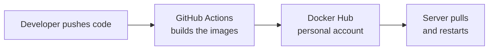
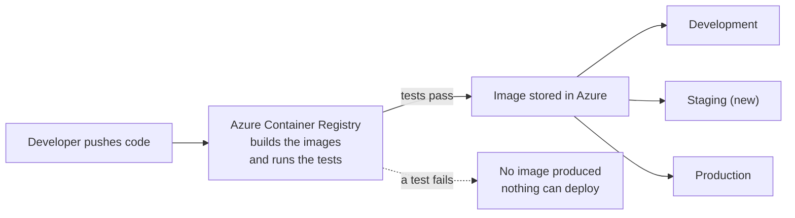

# Entrecore — Build and Deployment Migration

**Date:** 19 October 2026 · **Status:** proposal, nothing deployed yet
**Detail:** the full engineering version is `Entrecore-OI-Backend/deployment-architecture.md`

---

## 1. What we do today

- **GitHub Actions builds every image.** Each build takes about 15 minutes, billed as
  CI runner time, and that time grows with the codebase.
- **The images are stored in a personal Docker Hub account** — outside Azure and
  outside company control.
- **Two environments only: development and production.** There is no staging, and no
  automated test gate. A change can reach production without any test suite passing.

## 2. What we are moving to

- **The build moves into Azure.** Azure Container Registry builds the images itself;
  GitHub only signals that new code exists. No build minutes are consumed on GitHub.
- **The test suite becomes part of the build.** About 1,900 tests run before an image
  is published. If one fails, no image is produced — a failing change physically
  cannot be deployed.
- **A staging environment is added**, mirroring production. The exact image verified on
  staging is the one promoted to production, never a rebuild of it.
- **Images stay inside our Azure subscription**, pulled using each server's own Azure
  identity. No registry passwords are stored on any server.
- **Builds are automatic; releases stay deliberate.** Every merge produces a tested
  image; deploying it remains a human decision, with one-step rollback.
- **Logs move to one place.** Azure Monitor collects logs from all three environments,
  searchable centrally instead of by logging into each server.

## 3. Why

| Problem today | What changes |
|---|---|
| Build minutes billed on GitHub, rising with the codebase | Builds run in Azure on per-second compute, largely inside the free monthly allowance |
| Images held in a personal external account | Images held in our own Azure subscription, under company access control |
| Nothing prevents an untested change reaching production | Tests run inside the build; a failure means no deployable image exists |
| No staging — production is the first real environment | Staging mirrors production and is the required step before it |
| Registry credentials stored on each server | Servers authenticate with their own Azure identity; no stored passwords |
| Build, registry and hosting billed across three vendors | One Azure bill, one access model, one audit trail |

## 4. What we need: GitHub administrator approval

To build from a private repository, Azure needs its own read access to it. That is a
GitHub access token issued under the organisation that owns the code, with two minimal
permissions: read the code, and register the push notification that starts a build.

The request is blocked today because the organisation's token policy requires an
administrator to approve it — members cannot issue one themselves.

**Why there is no way around it:**

1. **It is the only credential Azure accepts.** Azure Container Registry supports a
   GitHub token and nothing else for a private repository source — there is no app
   integration or passwordless alternative. This is a platform limitation, not a
   configuration choice.
2. **The repository must stay private**, so anonymous access is not an option.
3. **Approval sits with an administrator by design.** The organisation's policy exists
   precisely to stop members granting access on its behalf. No Azure-side setting can
   substitute for it.
4. **It should not be a personal token even if one were possible.** A token tied to one
   employee's account stops all builds the day that account is disabled or they leave.
   The correct artefact is an organisation-approved token or a dedicated service
   account — and only an administrator can authorise either. The admin route is the
   right destination, not just the available one.

**The fallback, and what it costs.** There is one way to proceed without the token:
keep a small GitHub step that uploads the code to Azure and asks Azure to build it.
Azure still does the build, so no Docker build happens on GitHub — but it leaves
GitHub Actions in the release path, which is the dependency this migration exists to
remove, and builds could then only ever start from GitHub. We can run this way
temporarily if approval takes time. It is a workaround, not the target.

**Separately, on the Azure side** we need permission to create one new resource group
and assign roles within it. Nothing in the existing production group is touched.

## 5. Cost

| Item | Monthly (USD) |
|---|---|
| Azure Container Registry, Standard | $20 |
| Build compute | $0–6 |
| Centralised logging | $25–130 (usage-driven) |
| **Core subtotal** | **$45–156** |
| Staging environment — optional, new spend | $173–210 |

This replaces GitHub Actions build minutes and Docker Hub. Logging is the only
usage-driven line; a daily ingestion cap is set on day one so it cannot run away.
Staging is the one genuinely new cost and is a separate decision from the migration —
a smaller server would roughly halve it.

## 6. Sequence

Development first, production last.

1. Create the registry — affects nothing existing.
2. Switch development to it, verify, keep Docker Hub as fallback.
3. Add the test gate to the build.
4. Build the staging environment and make it the required step before production.
5. Switch production, in a quiet window, using an image already verified on staging.
6. Retire Docker Hub after about two weeks of successful running.

Production is only touched at step 5, and the previous image stays available for
immediate rollback throughout.
